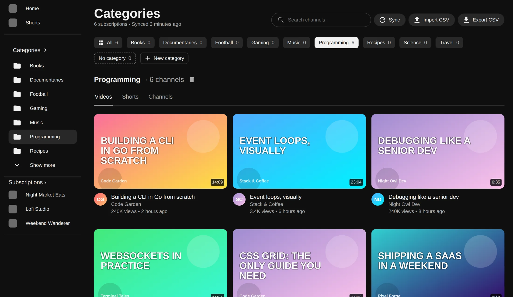

# Too Smart To Be Tube

[](https://github.com/iagosaito/too-smart-to-be-tube/actions/workflows/ci.yml)
[](https://github.com/iagosaito/too-smart-to-be-tube/actions/workflows/codeql.yml)
[](https://scorecard.dev/viewer/?uri=github.com/iagosaito/too-smart-to-be-tube)


**Organize your YouTube subscriptions into categories, right inside YouTube.**

**[See it in action → iagosaito.github.io/too-smart-to-be-tube](https://iagosaito.github.io/too-smart-to-be-tube/)**

[](https://iagosaito.github.io/too-smart-to-be-tube/)

Too Smart To Be Tube is a Chrome extension that adds a **Categories** entry to YouTube's sidebar. It opens a page
that looks and feels like part of YouTube, where you group the channels you follow (Programming, Music, Travel,
Recipes…), find them by name, and see which ones posted most recently.

No account, no server, no API key: everything runs in your browser and your data stays in it.

## Features

- **Lives inside YouTube.** A *Categories* entry in both the expanded and the collapsed sidebar opens a page
  within YouTube's own layout, following its light and dark themes.
- **All your subscriptions, synced automatically.** Reads your full subscription list (not just the channels
  shown in the sidebar), at most once an hour or on demand.
- **A feed per category.** Open a category to see the latest **videos and Shorts** from just those channels, in
  a grid that looks like YouTube's — straight from the sidebar.
- **Fast organizing.** Create categories inline, move one channel from its card, or select many channels and move
  them in one go.
- **Find things quickly.** Categories as chips in alphabetical order, accent-insensitive search, and per-view
  counts.
- **Sort by latest upload.** See which channels posted recently ("Video 2 days ago") and sort each category by
  recency.
- **CSV export and import.** Export everything to a spreadsheet, categorize it there (or with an assistant), and
  import it back. A review step shows exactly what will change, and you can undo it afterwards.
- **Speaks your YouTube language.** English, Portuguese and Spanish, following the language you picked on YouTube.
- **Keyboard and screen-reader friendly.** Real buttons and menus with focus management, arrow-key navigation
  and ARIA labels.

## Installation

The extension is not on the Chrome Web Store yet. To install it from source you need
[Node.js](https://nodejs.org/) 22 or newer.

```sh
git clone https://github.com/iagosaito/too-smart-to-be-tube.git
cd too-smart-to-be-tube
npm install
npm run build
```

Then load it in Chrome (or any Chromium browser such as Edge or Brave):

1. Open `chrome://extensions` and turn on **Developer mode**.
2. Click **Load unpacked** and select the project folder (the one containing `manifest.json`).
3. Open or refresh [youtube.com](https://www.youtube.com) while signed in.

## Usage

1. Click **Categories** in YouTube's sidebar. The first visit syncs your subscriptions and their latest videos in
   the background.
2. Your categories also appear in the sidebar: click one to open its **Videos** feed, switch to **Shorts**, or to
   **Channels** to organize it.
3. Create a category with **+ New category** in the chip bar.
4. Assign channels:
   - in **All**, use the category pill under each channel;
   - inside a category, hover a channel and use the move icon in its top-right corner;
   - to move many at once, tick the ✓ on several channels and pick a destination in the bar at the bottom.
5. Rename a category by clicking its title; delete it with the trash icon next to it.

### Organizing in bulk with CSV

**Export CSV** downloads `Channel, Category, URL, Identifier` for every subscription. Fill in the *Category*
column in any spreadsheet and use **Import CSV**:

- the file format is always in English, whatever language the interface is in;
- channels that are not in the file keep their current category;
- an empty *Category* cell (or `No category`) removes the channel from its category;
- both `,` and `;` separators are accepted, so files saved by Excel in any locale work.

## Languages

The interface follows the language you chose **on YouTube** (not your browser's), so switching YouTube to
Español switches the extension too.

| Language | Status |
| --- | --- |
| English | ✅ (also used for any language without a translation) |
| Português (Brasil) | ✅ |
| Español | ✅ |

Dates such as "Video 2 days ago" use your language's own formatting. Category names are yours and are never
translated. Want to add a language? See [CONTRIBUTING.md](CONTRIBUTING.md#adding-a-language).

## How it works

The extension is a single Manifest V3
[content script](https://developer.chrome.com/docs/extensions/develop/concepts/content-scripts) that runs on
`youtube.com`.

```
YouTube page
├── sidebar (expanded / collapsed) ── "Categories" entry, kept in place by MutationObservers
└── ytd-page-manager ─────────────── Categories page, rendered next to YouTube's own pages
        │
        ├── InnerTube (YouTube's internal web API, with your existing session)
        │     ├── /feed/channels ─────── full subscription list
        │     └── /feed/subscriptions ── latest upload per channel
        │
        └── chrome.storage.local ── channels, categories, preferences
```

- **Single-page app aware.** YouTube never reloads the page, so the script reacts to its `yt-navigate-*` events
  and re-inserts its sidebar entries whenever YouTube re-renders the menus.
- **Same requests YouTube makes.** Subscriptions and upload dates are read from YouTube's internal API using the
  session you are already logged in with, so no API key or OAuth consent is needed.
- **Trusted Types safe.** YouTube blocks `innerHTML`; all UI is built with `createElement`/`textContent`, which
  also means channel names can never inject HTML.
- **Feed without risking your account.** Category videos come from the subscriptions feed the sync already
  downloads (no extra requests). Shorts and older videos are read per channel through **public, cookie-less**
  requests, at a human pace (2 at a time, a cap per 10 minutes, automatic pause if YouTube asks), and cached for
  hours. Design notes: [docs/design/category-feed.md](docs/design/category-feed.md).
- **Fast with hundreds of channels.** Channel cards are cached and only the cards that changed are touched in the
  DOM, with `content-visibility` skipping off-screen work.

## Privacy

- Your subscriptions, categories and preferences are stored **only** in `chrome.storage.local` on your device.
- The extension talks **only to youtube.com**, using your existing session, to read your own subscriptions and
  subscription feed. There is no analytics, telemetry or third-party server.
- Exported CSV files are created locally in your browser.

## Permissions

| Permission | Why |
| --- | --- |
| `storage` | Save your categories and the cached subscription list locally. |
| Content script on `https://www.youtube.com/*` | Add the sidebar entry and the Categories page. Embedded players (`/embed/*`) are excluded. |

## Project structure

```
src/
├── content/   entry point: wiring, navigation events, extension-context handling
├── core/      pure logic: channels, categories, text normalization (no DOM, no chrome.*)
├── dom/       YouTube DOM: selectors, sidebar injection, DOM scraping, waitFor
├── export/    CSV generation
├── feed/      category feed: composition, per-channel cache and loading in batches
├── i18n/      language detection, translations (en, pt, es), plurals and relative dates
├── import/    CSV parsing and import planning
├── storage/   chrome.storage.local wrapper
├── sync/      sync coordinator and the rate-limited request queue
├── ui/        Categories page, components and styles
└── youtube/   InnerTube access: auth headers, subscriptions, latest uploads
tests/         Vitest + jsdom unit tests mirroring src/
```

## Development

| Command | Description |
| --- | --- |
| `npm run build` | Bundle the content script into `dist/content.js` with esbuild |
| `npm run watch` | Rebuild on every change |
| `npm test` | Run the unit tests |
| `npm run lint` | Run ESLint |

After a rebuild, reload the extension in `chrome://extensions` **and refresh the YouTube tab**.

Every push and pull request runs lint, tests and a build on Node 22 and 24, plus CodeQL code scanning and a
dependency review. See [CONTRIBUTING.md](CONTRIBUTING.md) for the coding guidelines.

## Contributing

Issues and pull requests are welcome. Please read [CONTRIBUTING.md](CONTRIBUTING.md) first, and report security
problems privately as described in [SECURITY.md](SECURITY.md).

## Disclaimer

This project is not affiliated with, endorsed by or sponsored by YouTube or Google. It relies on YouTube's web
interface and internal API, which may change without notice; when that happens, selectors live in
`src/dom/selectors.js` so they can be fixed in one place.
